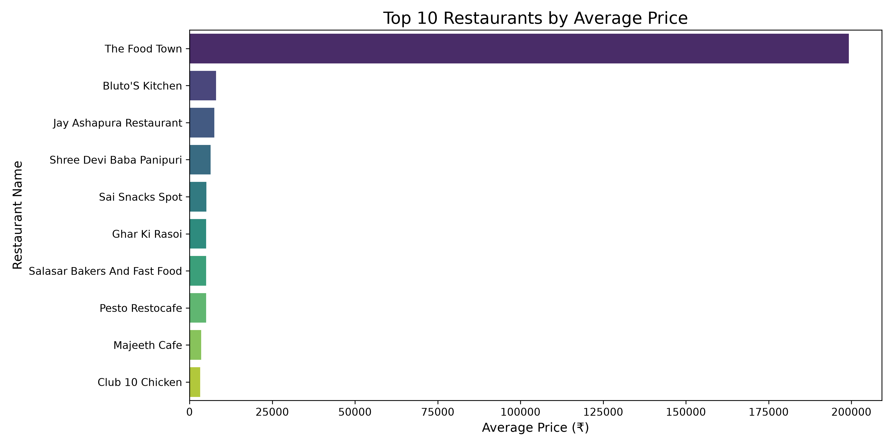
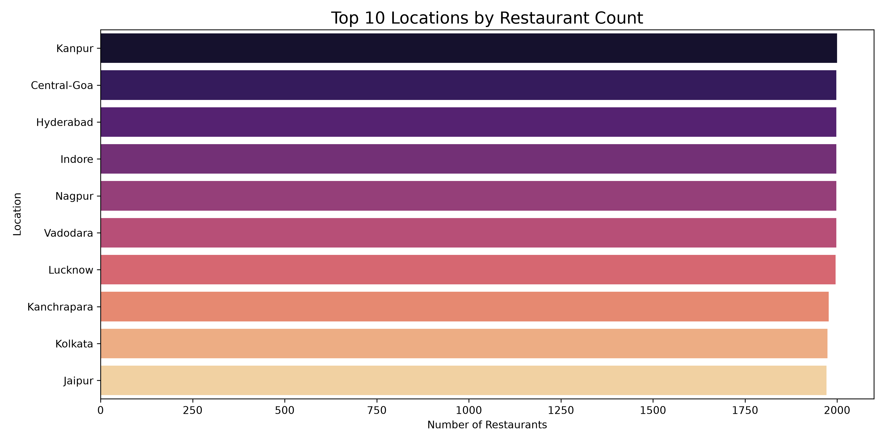
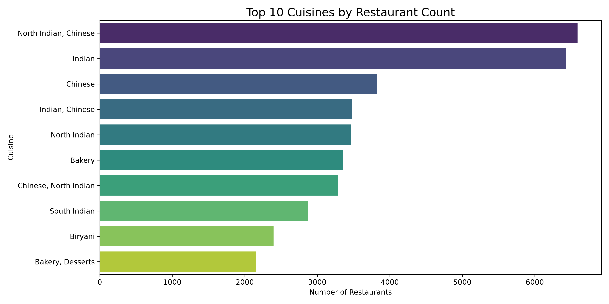
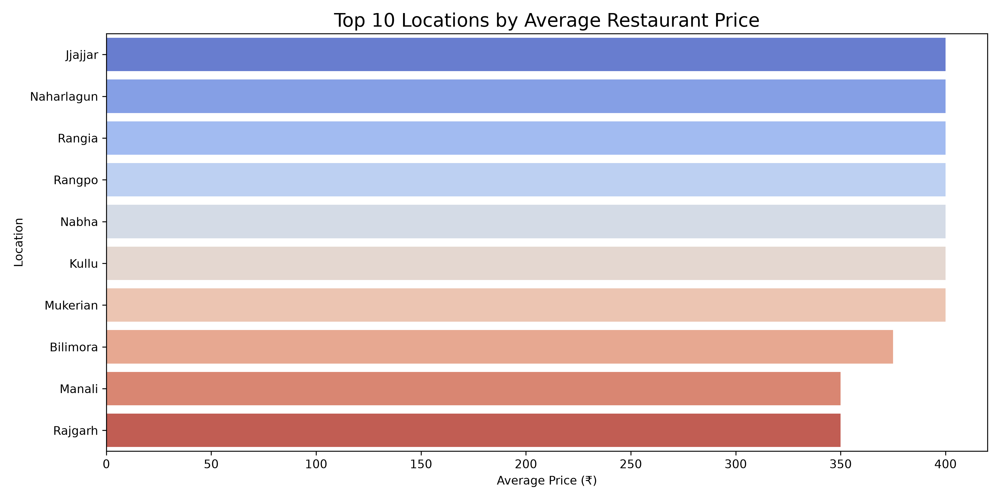

# Swiggy Data Analysis Project

## Project Overview
This project focuses on analyzing Swiggy restaurant data using Python.

## Tools & Technologies
- Python
- Pandas
- NumPy
- Matplotlib
- Seaborn

## Project Tasks
- Data Loading
- Data Cleaning
- Exploratory Data Analysis (EDA)
- Data Visualization

## Key Analysis
- Top 10 restaurants
- Top 10 locations
- Top cuisines
- Average price by location
- Most expensive restaurant

## Project Structure
- `data/raw/` – Original dataset
- `data/cleaned/` – Cleaned dataset
- `chart/` – Project visualizations
- `swiggy.py` – Python analysis code

## Conclusion
This project helps understand restaurant trends, pricing, cuisines, and locations using data analysis.

## Project Visualizations

### Top 10 Restaurants

### Top 10 Locations

### Top 10 Cuisines

### Average Price by Location

## Key Insights

1. Restaurant prices vary significantly across different restaurants.
2. Different locations have different restaurant pricing patterns.
3. The dataset contains multiple cuisines, showing food variety across locations.
4. Some restaurants have unusually high average prices and may require further investigation.
5. Restaurant ratings and rating counts can help understand customer preferences.

## Business Recommendations

1. Restaurants should maintain competitive pricing.
2. Restaurants should focus on popular cuisines in their locations.
3. Restaurants should improve food quality and customer satisfaction to maintain better ratings.
4. Businesses should investigate unusual pricing values before making decisions.
5. Restaurant owners can use location-based analysis to improve business strategies.

## Future Scope

- Customer preference analysis
- Restaurant rating comparison
- Advanced SQL analysis
- Interactive Power BI dashboard
- More detailed business insights

### Most Expensive Restaurant

- Restaurant Name: Grilliland BBQ
- Average Price: 450
- Location: Adilabad
